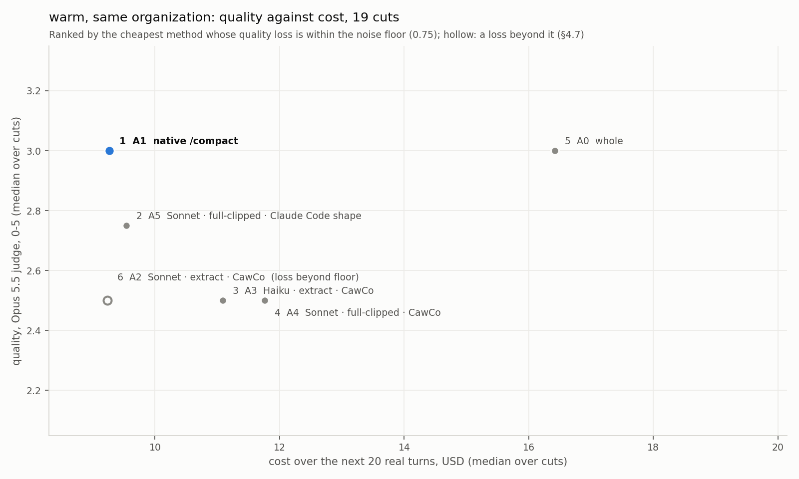
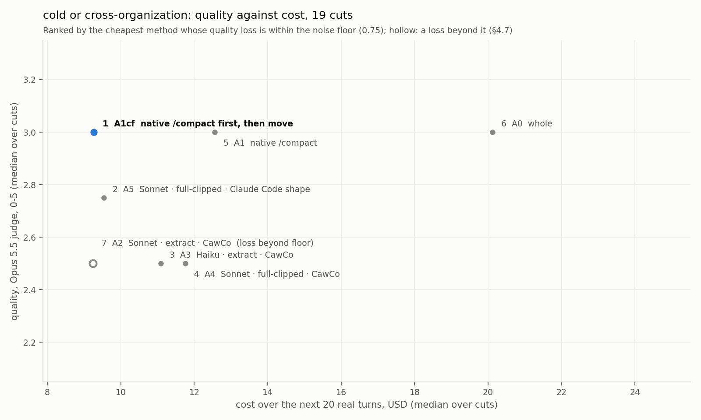
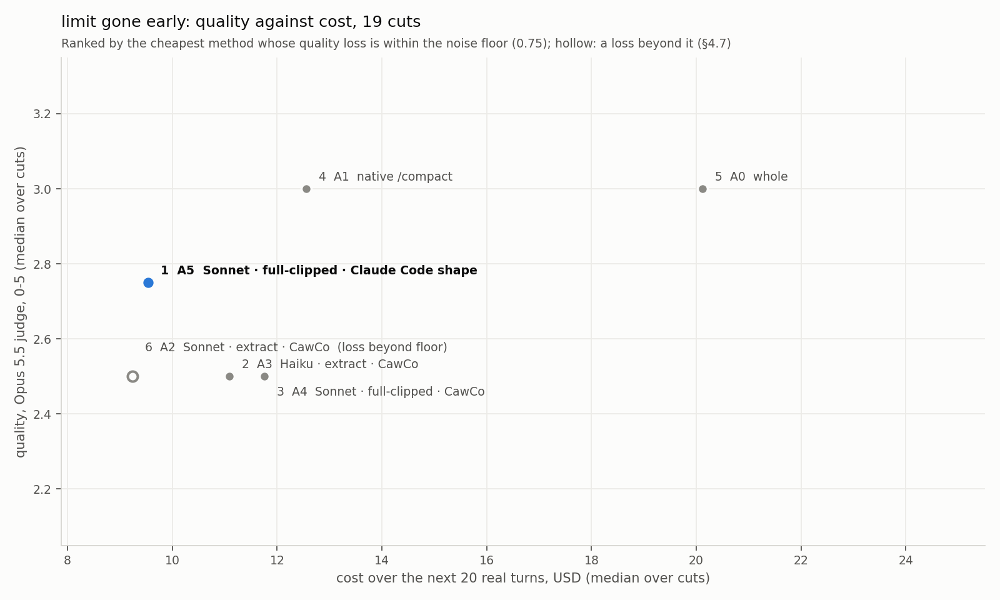

# Compaction methods ranked, per cache case

Written 2026-11-03T00:53:34.682Z by rank.py from out/. Quality: Opus 5.5's absolute 0-5 (mean of decision, artifact and continuation fidelity and no-repetition), median over runs then over cuts; Sonnet 5.5 beside it. Cost: make + turn 1 + the next 20 real turns (all of them where the session had fewer), each request priced on its own with the product's prices, median over runs then over cuts. Rank: every arm within the noise floor of the best quality, cheapest first; then the rest by quality (the design's rule: the cheapest method whose quality is not below the best by more than the noise floor). An arm is outside the floor only when its loss against the best arm is one §4.7 acts on: the 95 % CI of the paired Opus difference excludes zero, its median is at least the floor, and Sonnet's median difference has the same sign.

Noise floor: **0.75** (the larger of Nous's 0.3 and the 95th percentile of A0's 0-5 distance to its own repeats: 50 repeats at c01, c02, c03, c04, c05, c06, c07, c08, c09, c10, c11, c12, c13, c14, c15, c16, c17, c18, c19, c21, c22, c24). Δ quality is paired per cut against the best arm, 95 % bootstrap CI over cuts (10,000 resamples). Pairwise: the arm's turn against whole's turn of the same run, both orders; a win or loss counts only when both orders agree.

## What it says

- **Native `/compact` keeps the most.** Its quality ties whole (Opus median 3.00 against 3.00; pairwise against whole 25 wins, 6 ties, 26 losses), and no summary arm beats it.
- **Warm, same organization: native `/compact` is the default.** It ranks first over all 19 cuts ($9.26 against $16.41 for whole, next 20 turns), and first in every band but 600k+, where the three cuts whole could be judged at put every arm within $0.75 of each other.
- **Cold or cross-organization, with the source account still warm: compact first, then move** (A1cf). It is the cheapest arm within the floor ($9.26 against $20.11 for moving whole and $12.55 for compacting cold on the target), at both horizons and in every band but 600k+.
- **Limit gone early (nothing can run on the old account): a Sonnet summary of the full clipped transcript.** A5 (Claude Code's prompt) ranks first at 20 turns ($9.54) and A4 (CawCo's prompt, same input) first over the whole horizon ($32.57). Their difference is not actionable (report §1, E4). A4 is the only summary arm that is never outside the floor in any band or horizon. Native `/compact` run cold on the target stays within the floor but costs $12.55.
- **Today's CawCo summary input (A2, the extract that hides tool output) loses quality beyond the noise floor** against the best arm in every case over all cuts, at both horizons (Opus −0.75, 95 % CI −1.03 to −0.25; Sonnet −0.25), and in the 100-300k and 300-600k bands; only at 600k+ (3 cuts) is it within. It costs the same as native. Haiku (A3) is within the floor over all cuts but outside it at 100-300k.
- **Chained cuts (2 cuts, a second compaction):** every compacting arm loses about 1 point against whole. The Factory merge (A6) is the weakest, and two cuts settle nothing.
- **Not run:** OpenCode (A7d: its account's key expired) and pi (A7g: the ChatGPT account's Codex usage limit was reached on every probe).

Not run: **A7d**: OpenCode on opencode-go/deepseek-v4-pro was not run: the opencode-go account's key has expired (HTTP 401, api_key_expired, 2026-10-25), and the hub's own reading of that account still answered HTTP 401 on 2026-11-02. The owner, 2026-10-25: skip OpenCode and move on.; **A7g**: pi on openai-codex was not run: the ChatGPT account (257c55fd) answered "Codex error: The usage limit has been reached" on every probe, gpt-5.6-terra and gpt-6-luna alike: on 2026-10-25 from 04:30 to 09:04 UTC, and again on 2026-11-02 at 17:13 and 19:08 UTC.

## warm, same organization

Over the 19 single cuts where every arm here has both readings (c01, c02, c03, c04, c05, c06, c07, c08, c09, c10, c11, c12, c13, c14, c15, c16, c19, c22, c24).

| rank | arm | method | quality Opus 0-5 | Δ vs best (95 % CI) | Sonnet 0-5 (Δ) | within floor | cost, next 20 turns | Δ cost vs best quality | pairwise vs whole, w/t/l Opus · Sonnet |
|---|---|---|---|---|---|---|---|---|---|
| 1 | **A1** | native /compact | 3.00 | +0.00 [-0.24, +0.24] | 2.25 (+0.00) | yes | $9.26 | −$4.05 [-8.12, -3.77] | 25/6/26 · 24/14/19 |
| 2 | A5 | Sonnet · full-clipped · Claude Code shape | 2.75 | -0.50 [-0.96, -0.21] | 2.00 (-0.25) | yes | $9.54 | −$4.19 [-7.46, -3.19] | 20/7/30 · 19/9/29 |
| 3 | A3 | Haiku · extract · CawCo | 2.50 | -0.50 [-0.92, -0.22] | 1.75 (-0.50) | yes | $11.09 | −$3.89 [-7.36, -1.92] | 16/7/34 · 20/14/23 |
| 4 | A4 | Sonnet · full-clipped · CawCo | 2.50 | -0.50 [-0.89, -0.25] | 2.00 (-0.50) | yes | $11.76 | −$4.04 [-7.16, -1.78] | 14/5/38 · 16/9/32 |
| 5 | A0 | whole | 3.00 | +0.00 [+0.00, +0.00] | 2.25 (+0.00) | yes | $16.41 | +$0.00 [+0.00, +0.00] | — |
| 6 | A2 | Sonnet · extract · CawCo | 2.50 | -0.75 [-1.03, -0.25] | 2.00 (-0.25) | no | $9.23 | −$3.27 [-7.17, -3.00] | 16/4/37 · 11/14/32 |

Without whole (A0), over 21 cuts: 2 more where whole did not run or was not judged (c20, c23).

| rank | arm | method | quality Opus 0-5 | Δ vs best (95 % CI) | Sonnet 0-5 (Δ) | within floor | cost, next 20 turns | Δ cost vs best quality | pairwise vs whole, w/t/l Opus · Sonnet |
|---|---|---|---|---|---|---|---|---|---|
| 1 | **A2** | Sonnet · extract · CawCo | 2.50 | -0.50 [-0.90, -0.33] | 2.00 (-0.25) | yes | $9.23 | +$0.32 [+0.19, +1.30] | 16/4/37 · 11/14/32 |
| 2 | A1 | native /compact | 3.00 | +0.00 [+0.00, +0.00] | 2.25 (+0.00) | yes | $9.26 | +$0.00 [+0.00, +0.00] | 25/6/26 · 24/14/19 |
| 3 | A5 | Sonnet · full-clipped · Claude Code shape | 2.75 | -0.50 [-0.87, -0.32] | 2.00 (-0.25) | yes | $9.54 | +$0.46 [+0.15, +0.93] | 20/7/30 · 19/9/29 |
| 4 | A4 | Sonnet · full-clipped · CawCo | 2.50 | -0.50 [-0.83, -0.35] | 2.00 (-0.50) | yes | $11.76 | +$0.60 [+0.26, +2.58] | 14/5/38 · 16/9/32 |
| 5 | A3 | Haiku · extract · CawCo | 2.50 | -0.75 [-0.79, -0.31] | 1.75 (-0.25) | no | $11.09 | +$0.28 [+0.04, +2.31] | 16/7/34 · 20/14/23 |

Chained cuts, 2 cuts (c17, c18):

| rank | arm | method | quality Opus 0-5 | Δ vs best (95 % CI) | Sonnet 0-5 (Δ) | within floor | cost, next 20 turns | Δ cost vs best quality | pairwise vs whole, w/t/l Opus · Sonnet |
|---|---|---|---|---|---|---|---|---|---|
| 1 | **A0** | whole | 2.88 | +0.00 [+0.00, +0.00] | 1.50 (+0.00) | yes | $13.16 | +$0.00 [+0.00, +0.00] | — |
| 2 | A2 | Sonnet · extract · CawCo | 2.00 | -0.88 [-1.00, -0.75] | 1.50 (+0.00) | yes | $14.92 | +$1.76 [-1.27, +4.79] | 2/1/3 · 0/1/5 |
| 3 | A1 | native /compact | 1.88 | -1.00 [-1.25, -0.75] | 1.25 (-0.25) | no | $15.74 | +$2.58 [+0.84, +4.31] | 2/1/3 · 3/1/2 |
| 4 | A6 | Factory merge (chained) | 1.75 | -1.12 [-1.25, -1.00] | 1.25 (-0.25) | no | $14.42 | +$1.26 [-1.73, +4.24] | 1/1/4 · 1/3/2 |

## cold or cross-organization

Over the 19 single cuts where every arm here has both readings (c01, c02, c03, c04, c05, c06, c07, c08, c09, c10, c11, c12, c13, c14, c15, c16, c19, c22, c24).

| rank | arm | method | quality Opus 0-5 | Δ vs best (95 % CI) | Sonnet 0-5 (Δ) | within floor | cost, next 20 turns | Δ cost vs best quality | pairwise vs whole, w/t/l Opus · Sonnet |
|---|---|---|---|---|---|---|---|---|---|
| 1 | **A1cf** | native /compact first, then move | 3.00 | +0.00 [-0.24, +0.24] | 2.25 (+0.00) | yes | $9.26 | −$7.96 [-12.43, -6.77] | 25/6/26 · 24/14/19 |
| 2 | A5 | Sonnet · full-clipped · Claude Code shape | 2.75 | -0.50 [-0.96, -0.21] | 2.00 (-0.25) | yes | $9.54 | −$7.96 [-11.73, -6.23] | 20/7/30 · 19/9/29 |
| 3 | A3 | Haiku · extract · CawCo | 2.50 | -0.50 [-0.92, -0.22] | 1.75 (-0.50) | yes | $11.09 | −$7.83 [-11.59, -5.10] | 16/7/34 · 20/14/23 |
| 4 | A4 | Sonnet · full-clipped · CawCo | 2.50 | -0.50 [-0.89, -0.25] | 2.00 (-0.50) | yes | $11.76 | −$7.65 [-11.36, -4.96] | 14/5/38 · 16/9/32 |
| 5 | A1 | native /compact | 3.00 | +0.00 [-0.24, +0.24] | 2.25 (+0.00) | yes | $12.55 | −$6.49 [-9.97, -5.20] | 25/6/26 · 24/14/19 |
| 6 | A0 | whole | 3.00 | +0.00 [+0.00, +0.00] | 2.25 (+0.00) | yes | $20.11 | +$0.00 [+0.00, +0.00] | — |
| 7 | A2 | Sonnet · extract · CawCo | 2.50 | -0.75 [-1.03, -0.25] | 2.00 (-0.25) | no | $9.23 | −$7.62 [-11.41, -6.07] | 16/4/37 · 11/14/32 |

Without whole (A0), over 21 cuts: 2 more where whole did not run or was not judged (c20, c23).

| rank | arm | method | quality Opus 0-5 | Δ vs best (95 % CI) | Sonnet 0-5 (Δ) | within floor | cost, next 20 turns | Δ cost vs best quality | pairwise vs whole, w/t/l Opus · Sonnet |
|---|---|---|---|---|---|---|---|---|---|
| 1 | **A2** | Sonnet · extract · CawCo | 2.50 | -0.50 [-0.90, -0.33] | 2.00 (-0.25) | yes | $9.23 | −$0.79 [-2.14, -0.85] | 16/4/37 · 11/14/32 |
| 2 | A1cf | native /compact first, then move | 3.00 | +0.00 [+0.00, +0.00] | 2.25 (+0.00) | yes | $9.26 | −$1.71 [-2.85, -1.60] | 25/6/26 · 24/14/19 |
| 3 | A5 | Sonnet · full-clipped · Claude Code shape | 2.75 | -0.50 [-0.87, -0.32] | 2.00 (-0.25) | yes | $9.54 | −$1.17 [-2.26, -1.06] | 20/7/30 · 19/9/29 |
| 4 | A4 | Sonnet · full-clipped · CawCo | 2.50 | -0.50 [-0.83, -0.35] | 2.00 (-0.50) | yes | $11.76 | −$1.03 [-2.16, +0.53] | 14/5/38 · 16/9/32 |
| 5 | A1 | native /compact | 3.00 | +0.00 [+0.00, +0.00] | 2.25 (+0.00) | yes | $12.78 | +$0.00 [+0.00, +0.00] | 25/6/26 · 24/14/19 |
| 6 | A3 | Haiku · extract · CawCo | 2.50 | -0.75 [-0.79, -0.31] | 1.75 (-0.25) | no | $11.09 | −$1.19 [-2.43, +0.29] | 16/7/34 · 20/14/23 |

Chained cuts (a second compaction after replaying the real turns), 2 cuts (c17, c18):

| rank | arm | method | quality Opus 0-5 | Δ vs best (95 % CI) | Sonnet 0-5 (Δ) | within floor | cost, next 20 turns | Δ cost vs best quality | pairwise vs whole, w/t/l Opus · Sonnet |
|---|---|---|---|---|---|---|---|---|---|
| 1 | **A2** | Sonnet · extract · CawCo | 2.00 | -0.88 [-1.00, -0.75] | 1.50 (+0.00) | yes | $14.92 | −$4.29 [-8.38, -0.19] | 2/1/3 · 0/1/5 |
| 2 | A0 | whole | 2.88 | +0.00 [+0.00, +0.00] | 1.50 (+0.00) | yes | $19.21 | +$0.00 [+0.00, +0.00] | — |
| 3 | A1 | native /compact | 1.88 | -1.00 [-1.25, -0.75] | 1.25 (-0.25) | no | $19.79 | +$0.58 [-1.94, +3.09] | 2/1/3 · 3/1/2 |
| 4 | A1cf | native /compact first, then move | 1.88 | -1.00 [-1.25, -0.75] | 1.25 (-0.25) | no | $15.74 | −$3.47 [-6.27, -0.67] | 2/1/3 · 3/1/2 |
| 5 | A6 | Factory merge (chained) | 1.75 | -1.12 [-1.25, -1.00] | 1.25 (-0.25) | no | $14.42 | −$4.79 [-8.84, -0.74] | 1/1/4 · 1/3/2 |

## limit gone early

Over the 19 single cuts where every arm here has both readings (c01, c02, c03, c04, c05, c06, c07, c08, c09, c10, c11, c12, c13, c14, c15, c16, c19, c22, c24).

| rank | arm | method | quality Opus 0-5 | Δ vs best (95 % CI) | Sonnet 0-5 (Δ) | within floor | cost, next 20 turns | Δ cost vs best quality | pairwise vs whole, w/t/l Opus · Sonnet |
|---|---|---|---|---|---|---|---|---|---|
| 1 | **A5** | Sonnet · full-clipped · Claude Code shape | 2.75 | -0.50 [-0.96, -0.21] | 2.00 (-0.25) | yes | $9.54 | −$7.96 [-11.73, -6.23] | 20/7/30 · 19/9/29 |
| 2 | A3 | Haiku · extract · CawCo | 2.50 | -0.50 [-0.92, -0.22] | 1.75 (-0.50) | yes | $11.09 | −$7.83 [-11.59, -5.10] | 16/7/34 · 20/14/23 |
| 3 | A4 | Sonnet · full-clipped · CawCo | 2.50 | -0.50 [-0.89, -0.25] | 2.00 (-0.50) | yes | $11.76 | −$7.65 [-11.36, -4.96] | 14/5/38 · 16/9/32 |
| 4 | A1 | native /compact | 3.00 | +0.00 [-0.24, +0.24] | 2.25 (+0.00) | yes | $12.55 | −$6.49 [-9.97, -5.20] | 25/6/26 · 24/14/19 |
| 5 | A0 | whole | 3.00 | +0.00 [+0.00, +0.00] | 2.25 (+0.00) | yes | $20.11 | +$0.00 [+0.00, +0.00] | — |
| 6 | A2 | Sonnet · extract · CawCo | 2.50 | -0.75 [-1.03, -0.25] | 2.00 (-0.25) | no | $9.23 | −$7.62 [-11.41, -6.07] | 16/4/37 · 11/14/32 |

Without whole (A0), over 21 cuts: 2 more where whole did not run or was not judged (c20, c23).

| rank | arm | method | quality Opus 0-5 | Δ vs best (95 % CI) | Sonnet 0-5 (Δ) | within floor | cost, next 20 turns | Δ cost vs best quality | pairwise vs whole, w/t/l Opus · Sonnet |
|---|---|---|---|---|---|---|---|---|---|
| 1 | **A2** | Sonnet · extract · CawCo | 2.50 | -0.50 [-0.90, -0.33] | 2.00 (-0.25) | yes | $9.23 | −$0.79 [-2.14, -0.85] | 16/4/37 · 11/14/32 |
| 2 | A5 | Sonnet · full-clipped · Claude Code shape | 2.75 | -0.50 [-0.87, -0.32] | 2.00 (-0.25) | yes | $9.54 | −$1.17 [-2.26, -1.06] | 20/7/30 · 19/9/29 |
| 3 | A4 | Sonnet · full-clipped · CawCo | 2.50 | -0.50 [-0.83, -0.35] | 2.00 (-0.50) | yes | $11.76 | −$1.03 [-2.16, +0.53] | 14/5/38 · 16/9/32 |
| 4 | A1 | native /compact | 3.00 | +0.00 [+0.00, +0.00] | 2.25 (+0.00) | yes | $12.78 | +$0.00 [+0.00, +0.00] | 25/6/26 · 24/14/19 |
| 5 | A3 | Haiku · extract · CawCo | 2.50 | -0.75 [-0.79, -0.31] | 1.75 (-0.25) | no | $11.09 | −$1.19 [-2.43, +0.29] | 16/7/34 · 20/14/23 |

Chained cuts (a second compaction after replaying the real turns), 2 cuts (c17, c18):

| rank | arm | method | quality Opus 0-5 | Δ vs best (95 % CI) | Sonnet 0-5 (Δ) | within floor | cost, next 20 turns | Δ cost vs best quality | pairwise vs whole, w/t/l Opus · Sonnet |
|---|---|---|---|---|---|---|---|---|---|
| 1 | **A2** | Sonnet · extract · CawCo | 2.00 | -0.88 [-1.00, -0.75] | 1.50 (+0.00) | yes | $14.92 | −$4.29 [-8.38, -0.19] | 2/1/3 · 0/1/5 |
| 2 | A0 | whole | 2.88 | +0.00 [+0.00, +0.00] | 1.50 (+0.00) | yes | $19.21 | +$0.00 [+0.00, +0.00] | — |
| 3 | A1 | native /compact | 1.88 | -1.00 [-1.25, -0.75] | 1.25 (-0.25) | no | $19.79 | +$0.58 [-1.94, +3.09] | 2/1/3 · 3/1/2 |
| 4 | A6 | Factory merge (chained) | 1.75 | -1.12 [-1.25, -1.00] | 1.25 (-0.25) | no | $14.42 | −$4.79 [-8.84, -0.74] | 1/1/4 · 1/3/2 |

## Robustness

The order under the same rule, at the next 20 turns (above) and over the session's whole horizon (to its next compaction or its end), over all single cuts and per context band. Cells: arm and its median cost; an arm with a loss beyond the floor is struck out and put last.

| case | cuts | horizon | order (cheapest within the floor first) |
|---|---|---|---|
| warm, same organization · all | 19 | 20 turns | A1 $9.26, A5 $9.54, A3 $11.09, A4 $11.76, A0 $16.41, ~~A2 $9.23~~ |
| warm, same organization · all | 18 | whole | A1 $31.79, A4 $32.57, A3 $33.10, A5 $33.20, A0 $40.88, ~~A2 $33.55~~ |
| warm, same organization · 100-300k | 8 | 20 turns | A1 $7.52, A4 $8.44, A0 $9.24, ~~A5 $8.20~~, ~~A2 $7.69~~, ~~A3 $8.99~~ |
| warm, same organization · 100-300k | 8 | whole | A1 $40.90, A4 $41.22, A0 $47.87, ~~A5 $41.24~~, ~~A2 $41.59~~, ~~A3 $41.40~~ |
| warm, same organization · 300-600k | 8 | 20 turns | A1 $13.04, A5 $13.55, A4 $13.79, A3 $14.05, A0 $17.98, ~~A2 $14.28~~ |
| warm, same organization · 300-600k | 7 | whole | A1 $26.71, A4 $27.78, A0 $31.91, ~~A3 $28.36~~, ~~A5 $29.11~~, ~~A2 $29.36~~ |
| warm, same organization · 600k+ | 3 | 20 turns | A3 $7.92, A2 $8.13, A5 $8.50, A1 $8.56, A4 $8.67, A0 $19.23 |
| warm, same organization · 600k+ | 3 | whole | A3 $13.00, A2 $13.22, A5 $13.58, A1 $13.74, A4 $13.77, A0 $38.92 |
| cold or cross-organization · all | 19 | 20 turns | A1cf $9.26, A5 $9.54, A3 $11.09, A4 $11.76, A1 $12.55, A0 $20.11, ~~A2 $9.23~~ |
| cold or cross-organization · all | 18 | whole | A1cf $31.79, A4 $32.57, A3 $33.10, A5 $33.20, A1 $34.54, A0 $44.77, ~~A2 $33.55~~ |
| cold or cross-organization · 100-300k | 8 | 20 turns | A1cf $7.52, A4 $8.44, A1 $8.55, A0 $11.05, ~~A5 $8.20~~, ~~A2 $7.69~~, ~~A3 $8.99~~ |
| cold or cross-organization · 100-300k | 8 | whole | A1cf $40.90, A4 $41.22, A1 $41.46, A0 $49.01, ~~A5 $41.24~~, ~~A2 $41.59~~, ~~A3 $41.40~~ |
| cold or cross-organization · 300-600k | 8 | 20 turns | A1cf $13.04, A5 $13.55, A4 $13.79, A3 $14.05, A1 $15.74, A0 $22.67, ~~A2 $14.28~~ |
| cold or cross-organization · 300-600k | 7 | whole | A1cf $26.71, A4 $27.78, A1 $31.85, A0 $40.48, ~~A3 $28.36~~, ~~A5 $29.11~~, ~~A2 $29.36~~ |
| cold or cross-organization · 600k+ | 3 | 20 turns | A3 $7.92, A2 $8.13, A5 $8.50, A1cf $8.56, A4 $8.67, A1 $12.55, A0 $26.08 |
| cold or cross-organization · 600k+ | 3 | whole | A3 $13.00, A2 $13.22, A5 $13.58, A1cf $13.74, A4 $13.77, A1 $17.73, A0 $45.77 |
| limit gone early · all | 19 | 20 turns | A5 $9.54, A3 $11.09, A4 $11.76, A1 $12.55, A0 $20.11, ~~A2 $9.23~~ |
| limit gone early · all | 18 | whole | A4 $32.57, A3 $33.10, A5 $33.20, A1 $34.54, A0 $44.77, ~~A2 $33.55~~ |
| limit gone early · 100-300k | 8 | 20 turns | A4 $8.44, A1 $8.55, A0 $11.05, ~~A5 $8.20~~, ~~A2 $7.69~~, ~~A3 $8.99~~ |
| limit gone early · 100-300k | 8 | whole | A4 $41.22, A1 $41.46, A0 $49.01, ~~A5 $41.24~~, ~~A2 $41.59~~, ~~A3 $41.40~~ |
| limit gone early · 300-600k | 8 | 20 turns | A5 $13.55, A4 $13.79, A3 $14.05, A1 $15.74, A0 $22.67, ~~A2 $14.28~~ |
| limit gone early · 300-600k | 7 | whole | A4 $27.78, A1 $31.85, A0 $40.48, ~~A3 $28.36~~, ~~A5 $29.11~~, ~~A2 $29.36~~ |
| limit gone early · 600k+ | 3 | 20 turns | A3 $7.92, A2 $8.13, A5 $8.50, A4 $8.67, A1 $12.55, A0 $26.08 |
| limit gone early · 600k+ | 3 | whole | A3 $13.00, A2 $13.22, A5 $13.58, A4 $13.77, A1 $17.73, A0 $45.77 |

